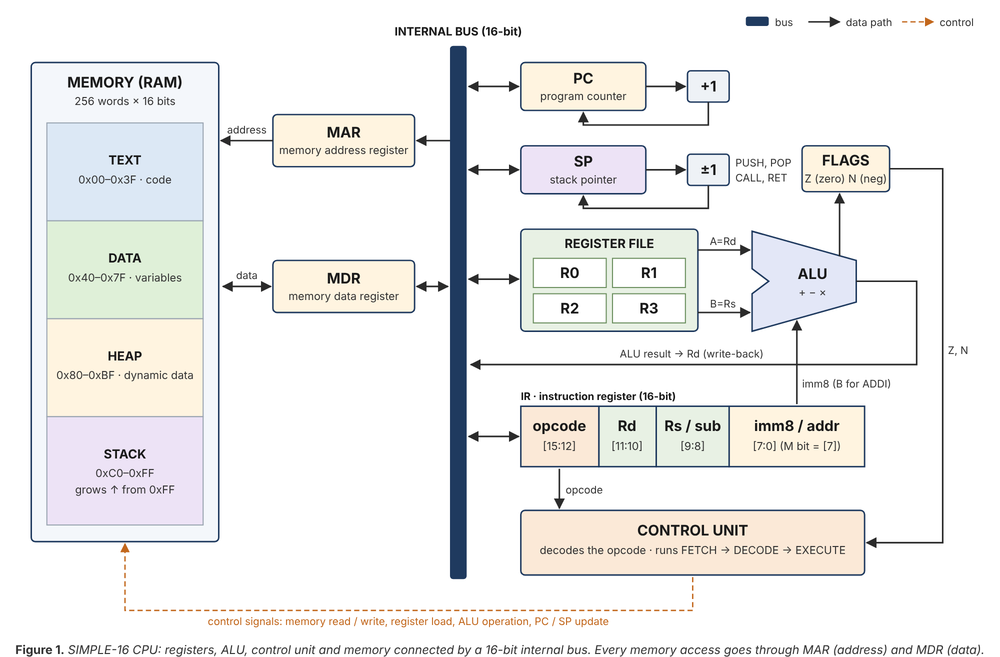
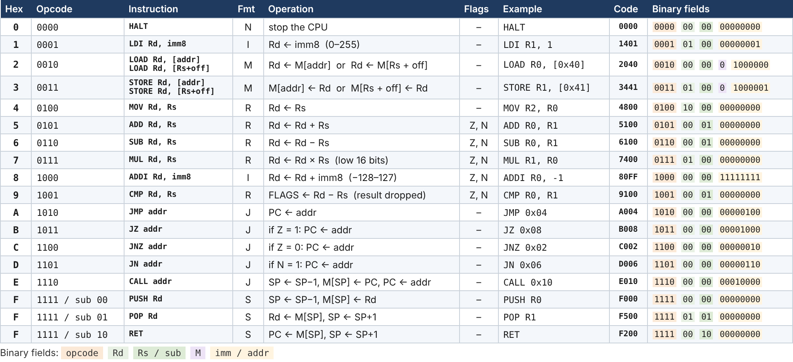

# SIMPLE-16 CPU

A 16-bit CPU of our own design, with an assembler, loader, and simulator written in C.
CMPE 220 team project: **CPU Design** (Part 1) and **Program Layout & Execution** (Part 2).

## Part 1: CPU Design

### Architecture Overview

```
┌──────────────────────────────────────────────────────────────────┐
│           SIMPLE-16 CPU  (16-bit words, 4-bit opcode)            │
│                                                                  │
│   ┌──────────────┐    ┌──────────────┐    ┌────────────────────┐ │
│   │ Control Unit │    │     ALU      │    │     Registers      │ │
│   │              │    │              │    │                    │ │
│   │    Fetch     │    │   ADD  SUB   │    │   R0  R1  R2  R3   │ │
│   │    Decode    │    │   MUL  CMP   │    │     PC  IR  SP     │ │
│   │   Execute    │    │     ADDI     │    │      MAR  MDR      │ │
│   │              │    │  flags Z, N  │    │       FLAGS        │ │
│   └──────────────┘    └──────────────┘    └────────────────────┘ │
│           │                   │                      │           │
│           └───────────────────┼──────────────────────┘           │
│                               │  16-bit internal bus             │
│                               │  MAR = address, MDR = data       │
│                               ▼                                  │
│           ┌──────────────────────────────────────┐               │
│           │ MEMORY  (256 words x 16 bits)        │               │
│           │                                      │               │
│           │ 0x00 - 0x3F   Text    code           │               │
│           │ 0x40 - 0x7F   Data    variables      │               │
│           │ 0x80 - 0xBF   Heap    dynamic data   │               │
│           │ 0xC0 - 0xFF   Stack   grows down     │               │
│           └──────────────────────────────────────┘               │
│                                                                  │
└──────────────────────────────────────────────────────────────────┘
```



### Architecture
| Item | Choice |
|---|---|
| Word size | 16 bits. Every instruction, number, and memory cell is one word |
| Instruction length | Always 1 word (16 bits) |
| Opcode | 4 bits → 16 primary opcode groups, 18 mnemonics. The first hex digit of an instruction is its opcode |
| General registers | R0, R1, R2, R3 (16-bit) |
| Special registers | PC (program counter), IR (instruction register), FLAGS, SP (stack pointer), MAR (memory address register), MDR (memory data register) |
| Flags | Z = result is zero, N = result is negative (bit 15). Set by ADD, SUB, MUL, ADDI, CMP |
| Memory | 256 words × 16 bits, addresses 0x00–0xFF |

### Memory Layout
| Segment | Addresses | Holds |
|---|---|---|
| Text | 0x00–0x3F | Program code |
| Data | 0x40–0x7F | Global variables |
| Heap | 0x80–0xBF | Dynamic data (used in Part 2) |
| Stack | 0xC0–0xFF | Return addresses and saved registers (used in Part 2). Grows down from 0xFF |

### Instruction Formats
Bit 15 is on the left.
```
R  [ op 4 | Rd 2 | Rs 2  | 0000 0000     ]   MOV ADD SUB MUL CMP
I  [ op 4 | Rd 2 | 00    | imm 8         ]   LDI ADDI
M  [ op 4 | Rd 2 | Rs 2  | M 1 | addr 7  ]   LOAD STORE
J  [ op 4 | 00   | 00    | addr 8        ]   JMP JZ JNZ JN CALL
S  [ op 4 | Rd 2 | sub 2 | 0000 0000     ]   PUSH POP RET
N  [ op 4 | 0000 0000 0000               ]   HALT
```
- **Register codes:** R0 = 00, R1 = 01, R2 = 10, R3 = 11
- **M bit (LOAD/STORE):**
  - 0 = direct, address = addr7 (0x00–0x7F)
  - 1 = register + offset, address = Rs + offset (0–127)
- **sub field (opcode F):** 00 = PUSH, 01 = POP, 10 = RET

### Instruction Encoding



**Hand-encoding example:** `MUL R1, R0`

| opcode | Rd | Rs | unused | → | hex |
|---|---|---|---|---|---|
| `0111` (MUL) | `01` (R1) | `00` (R0) | `00000000` | → | `0x7400` |

More examples: [docs/hand_encoding_examples.png](docs/hand_encoding_examples.png)

### Assembler

Two-pass assembler (`src/assembler.c`):
- **Pass 1:** reads the file, records labels, gives each line an address (`.text` from 0x00, `.data` from 0x40)
- **Pass 2:** parses operands and encodes each line into a 16-bit word
- Reports an error for jump targets outside the text segment and `.word` values that don't fit in 16 bits

```asm
        .text
start:  LOAD  R0, [base]     ; direct address
        LDI   R2, 1
loop:   MUL   R2, R0
        JNZ   loop
        HALT
        .data
base:   .word 8
```

### Simulator Code Structure

| Part of the CPU | Code |
|---|---|
| Registers (GPR, SPR), flags, RAM | `CPU` struct in `src/cpu.h` |
| Bus (address, data, R/W control) | `Bus` struct, `read_memory()` / `write_memory()` in `src/cpu.c` |
| ALU | `Alu` struct, `alu()` in `src/cpu.c` |
| Clock and instruction cycle | `fetch()`, `decode_ir()`, `execute()`, `tick()` in `src/cpu.c` |
| Loader (program into RAM) | `cpu_load_program()` in `src/loader.c` |
| Display of CPU and RAM | `src/trace.c` |

### Example Programs

| Program | Written in | Computes | Result |
|---|---|---|---|
| `programs/add.asm` | C (`add.c`), translated by hand | 25 + 17 | 42 |
| `programs/mul.asm` | C (`mul.c`), translated by hand | 6 × 7 | 42 |
| `programs/factorial.asm` | C (`factorial.c`), translated by hand | 8! | 40320 |
| `programs/square.asm` | SIMPLE-16 assembly directly | 8² | 64 |

### Build and Run

Needs a C compiler, `make` and Python 3 (for tests).

```sh
make                                          # build simulator + native C versions
./build/simple16 programs/add.asm             # run, print result
./build/simple16 --trace programs/add.asm     # RAM after loading, then every clock tick
./build/simple16 --listing programs/add.asm   # assembled binary of each line
./build/simple16 --isa                        # instruction set table with binary codes
./build/factorial                             # native C version of a program (also add, mul)
make test                                     # all tests
make traces                                   # traces of all programs in build/traces/
make sanitize                                 # tests again with undefined-behavior checks
```

### Trace Output (one instruction)

```
SNAPSHOT step=2 executed=0x0001 word=0x7000 MUL R0, R0   [0111 00 00 00000000]
  CLK 4    FETCH    bus READ  addr=0x01 data=0x7000 | MAR=0x01 MDR=0x7000 -> IR=0111 0000 0000 0000, PC=0x02
  CLK 5    DECODE   0111 00 00 00000000 -> MUL R0, R0
  CLK 6    EXECUTE  ALU 0x0008 * 0x0008 = 0x0040 | bus idle | PC=0x02
  GPR  R0=0x0040(64) R1=0x0000(0) R2=0x0000(0) R3=0x0000(0)
  SPR  PC=0x0002 IR=0x7000 SP=0x0100 MAR=0x0001 MDR=0x7000
  ALU  0x0008 * 0x0008 = 0x0040   FLAGS Z=0 N=0
  RAM  addr  binary               hex   ASCII
       0x00  0010 0000 0100 0000  2040  | @|
       0x01  0111 0000 0000 0000  7000  |p.|
       ...
```

| Line | Shows |
|---|---|
| `CLK n FETCH` | Bus read of the instruction at PC into IR, PC + 1 |
| `CLK n DECODE` | IR split into its binary fields and the instruction |
| `CLK n EXECUTE` | ALU operation and/or bus read/write, and the PC after it (shows jumps) |
| `GPR` / `SPR` / `ALU` | Registers, ALU and flags after the instruction |
| `RAM` | Code and data words in binary, hex and ASCII (`.` = not printable) |

## Part 2: Program Layout & Execution

A separate recursive example preserves the iterative Part 1 program:

```sh
make
./build/factorial_recursive                  # native recursive C: prints 24
./build/simple16 programs/factorial_recursive.asm
make recursive-trace                       # build/traces/factorial_recursive.txt
./build/simple16 --trace-segments programs/factorial_recursive.asm
```

`programs/factorial_recursive.c` calls `factorial` from `main`. Its assembly
translation uses the same structure: `CALL factorial` passes n in R1, and R0
returns the answer. The default input is 4 to keep the call sequence short;
the native reference accepts 0..8. The base case is `n == 0`.

| Recursive C operation | Assembly operation |
|---|---|
| main calls factorial(input) | LOAD R1, [input]; CALL factorial |
| if (n == 0) return 1 | LDI R2, 0; CMP R1, R2; JZ base; base: LDI R0, 1; RET |
| Preserve n while evaluating factorial(n - 1) | PUSH R1; ADDI R1, -1; CALL factorial |
| Multiply by this call's n and return | POP R2; MUL R0, R2; RET |
| main saves the returned value | STORE R0, [result]; HALT |

Each CALL pushes a return address. Each non-base call also pushes its n before
calling again; POP restores n and RET restores the return address. For input 4,
the deepest SP is 0xF7 (nine live stack words). SP returns to 0x100 at HALT.
Popped words remain in RAM as inactive contents; SP identifies the live stack.
R1 is a caller-clobbered argument register, R2 is scratch, and R0 is the return
register. No heap allocation is used.

`--trace-segments` prints the loaded state and every completed instruction,
including each CALL, RET and HALT. Every snapshot shows all 256 words in named
text, data, heap and stack blocks. This includes loading, entry to every recursive
call, and completion; the unused heap remains visible. The existing `--trace`
mode retains its compact instruction/data block for Part 1. Both modes run the
same CPU engine. `make test` checks native C agreement, saved return addresses,
saved n values, call/return counts, full segment coverage and stack restoration.

The CPU Design PDF remains focused on Part 1. The recursive example and its
four-segment trace provide execution evidence for a separate Part 2 report.